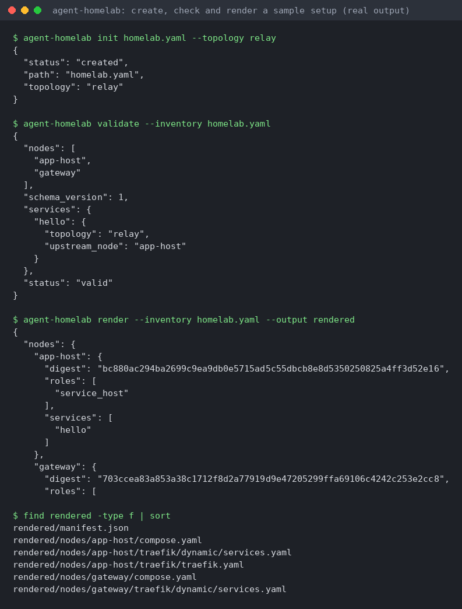
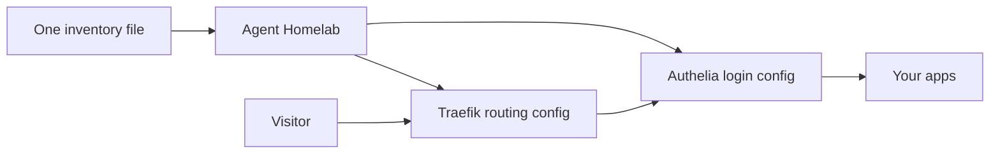

# Agent Homelab

> **About this copy:** this is a personal fork of [CochranResearchGroup/agent-homelab](https://github.com/CochranResearchGroup/agent-homelab). The original project's documentation continues below.

**In one sentence:** Agent Homelab sets up the 'front door' for web apps you host at home: from one settings file it produces the routing (Traefik) and login protection (Authelia) configuration.

**Who it is for:** People self-hosting several web apps who want one sign-in protecting all of them.



*Real output: from one sample inventory file to ready-made Traefik and compose files for each machine.*

**How it works:**



---


Agent Homelab turns one privacy-safe inventory into Traefik and Authelia configuration for a single host, a service host relayed through a separate edge gateway, or a home server behind a Cloudflare Tunnel. It includes a Python CLI, a sanitized service catalog, guarded Borg backups, and eight agent skills for setup and operations.

## Supported topology

```text
Direct: Internet -> edge Traefik -> local service
Relay:  Internet -> edge Traefik -> service-host Traefik -> service
Tunnel: Internet -> Cloudflare -> cloudflared -> loopback Traefik -> bridge socket -> host service
                         |
                         +-> Authelia for protected routes
```

A node can have `service_host`, `edge_gateway`, or both roles. LAN and existing Tailscale/WireGuard addresses are ordinary node addresses; Agent Homelab does not install a mesh VPN.

## Install

Python 3.11+, Docker Compose, and OpenSSH are supported on Linux.

```bash
python -m pip install \
  https://github.com/CochranResearchGroup/agent-homelab/releases/download/v0.2.0-rc.2/agent_homelab-0.2.0rc2-py3-none-any.whl
agent-homelab --version
```

For development:

```bash
python -m venv .venv
.venv/bin/pip install -e '.[dev]'
```

## First setup

Create an ignored site inventory and inspect prerequisites:

```bash
agent-homelab init homelab.yaml --topology relay
agent-homelab doctor --inventory homelab.yaml
agent-homelab validate --inventory homelab.yaml
agent-homelab render --inventory homelab.yaml --output rendered
agent-homelab bootstrap --inventory homelab.yaml --node gateway --acme-email operator@example.invalid
```

Review the rendered node trees before deployment:

```bash
agent-homelab plan --inventory homelab.yaml --rendered rendered --node app-host
agent-homelab apply --inventory homelab.yaml --rendered rendered --node app-host --dry-run
```

Remove `--dry-run` only after the plan, destination, validation command, and rollback path are correct.

`bootstrap` is plan-only until `--apply` is provided. It creates persistent state directories and missing secret material without overwriting existing files. Use `recovery-bundle` to create a mode-`0600` non-secret recovery archive alongside encrypted backups of persistent state.

## Add a service

Keep each service in an operator-owned Docker Compose project directory and use it as the deployment authority. Portainer is available as an optional recipe for visibility or manual diagnostics, but it isn't the recommended control plane for agent-managed stacks.

```bash
agent-homelab recipe policy
agent-homelab service upsert photos \
  --inventory homelab.yaml \
  --upstream-node app-host \
  --port 2283 \
  --port-source 'compose.yaml IMMICH_PORT=2283' \
  --local-hostname photos.localhost \
  --public-hostname photos.example.net \
  --edge-node gateway \
  --auth-policy one_factor
```

Protected services render both the Traefik forward-auth middleware and a matching Authelia access-control rule. Route reachability and application proxy correctness remain separate validation gates.

## Inventory and secrets

Start from [`homelab.example.yaml`](homelab.example.yaml). Real `homelab.yaml`, `secrets/`, `.env`, OAuth state, ACME state, and rendered output are ignored. Inventory may contain secret references such as environment-variable names, but inline secret fields are rejected.

The schema is versioned. Use `agent-homelab migrate --inventory old.yaml --output homelab.yaml` to create a validated current inventory without overwriting the source.

Optional [Tailscale policy access](docs/guides/tailscale-policy.md) adds private OAuth enrollment, raw policy snapshots and candidate validation. Start with a scoped reader; conditional writes require a separate configured writer and an explicitly reviewed candidate. It uses the existing mesh and leaves ingress configuration separate.

## Agent skills

| Skill | Phase | Purpose |
|---|---|---|
| `homelab-bootstrap` | Project start | Discover and bootstrap direct, combined, or relay topology |
| `homelab-service-catalog` | Build | Install catalog services with ingress and recovery boundaries |
| `homelab-service-ingress` | Operations | Add or change a service and verify proxy behavior |
| `homelab-borg-backup` | Operations | Configure, check, and stage restores from encrypted Borg backups |
| `homelab-maintenance` | Maintenance | Detect drift, validate health, and perform guarded upgrades |
| `homelab-oauth-relay` | Operations | Install and test the optional headless OAuth relay |
| `homelab-mcp-connector` | Operations | Publish an OAuth-protected MCP server and register chat apps as Authelia clients; connect them with `mcp-onboarding` |
| `homelab-troubleshooter` | Runbook | Classify DNS, TLS, edge, auth, relay, origin, and app failures |

Copy a skill directory into the skill location used by your agent, or let the agent read it directly from this repository.

## Documentation

- [Architecture](docs/architecture/overview.md)
- [First homelab](docs/guides/first-homelab.md)
- [Service catalog](docs/guides/service-catalog.md)
- [Borg backups](docs/guides/borg-backups.md)
- [Direct-host setup](docs/guides/direct-host.md)
- [Bastion relay](docs/guides/bastion-relay.md)
- [Cloudflare Tunnel edge](docs/guides/tunnel-edge.md)
- [Authelia](docs/guides/authentication.md)
- [OAuth relay](docs/guides/oauth-relay.md)
- [Disaster recovery](docs/guides/disaster-recovery.md)
- [Supported versions](docs/supported-versions.md)
- [Security scanning policy](docs/security-scanning.md)

## V1 boundaries

V1 does not automate registrar DNS, install mesh VPNs, orchestrate SSH tunnels, deploy Kubernetes/Nomad, or provide a web control plane. It expects existing address reachability and explicit operator-owned secrets.

## Security

Read [SECURITY.md](SECURITY.md) before exposing services. Never file an issue containing inventory, credentials, callback URLs with authorization codes, or private network details.
